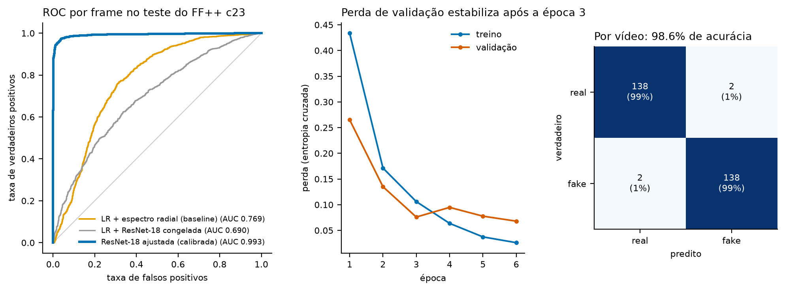

# Marco 2 — Seção 3 (rascunho, tarefa D1)

> Gerado a partir de `derived/agent/tabela_modelos.csv` e `derived/agent/metricas_modelo_final.json`. Todos os números vêm desses arquivos; se o modelo for retreinado, rode `ml/compare_models.py` e `ml/final_model_metrics.py` e atualize aqui.

## 3. Modelo Final Escolhido

### 3.1 Tabela comparativa de modelos

Teste oficial do FF++ c23: 2800 frames de 280 vídeos (50% fake). Real = vídeos originais; fake = FaceSwap. Limiar 0,5. IC95% da AUC por bootstrap agrupado por vídeo alvo (2.000 reamostragens). Acurácia, F1, AUC e Brier são por frame; a penúltima coluna dá acurácia / AUC por vídeo (média das probabilidades dos 10 frames).

| Modelo | Acurácia | F1 | AUC-ROC (IC95%) | Brier | Vídeo: acc / AUC | Custo / Interpretabilidade |
|---|---|---|---|---|---|---|
| LR + 8 atributos manuais | 0.655 | 0.671 | 0.705 [0.665, 0.747] | 0.218 | 0.668 / 0.726 | segundos em CPU; coeficientes legiveis |
| LR + espectro radial (baseline) | 0.725 | 0.733 | 0.769 [0.731, 0.805] | 0.196 | 0.732 / 0.792 | segundos em CPU; 128 coeficientes, direcao interpretavel |
| LR + ResNet-18 congelada | 0.640 | 0.638 | 0.690 [0.663, 0.721] | 0.225 | 0.675 / 0.738 | ~10 min de extracao em CPU; caixa-preta nas features |
| ResNet-18 ajustada (CNN), bruta | 0.968 | 0.968 | 0.993 [0.988, 0.997] | 0.027 | 0.986 / 0.999 | ~46 min de treino em CPU; ~46 img/s na inferencia; caixa-preta |
| ResNet-18 ajustada (CNN), calibrada (T) | 0.968 | 0.968 | 0.993 [0.988, 0.997] | 0.027 | 0.986 / 0.999 | igual, + 1 parametro (T) ajustado na validacao |

Os três primeiros modelos reproduzem exatamente os números do baseline do Marco 1. As duas últimas linhas são a mesma rede; a diferença é só a temperatura aplicada à saída.

### 3.2 Modelo final e justificativa

**Modelo final de ML (classificador de pixels): ResNet-18 pré-treinada no ImageNet, ajustada nos recortes de rosto do FF++ c23, com saída calibrada por temperature scaling (T = 1.158).**

- **Desempenho.** É o único modelo que supera o baseline com folga: AUC por frame de 0.993 contra 0,769 da regressão logística sobre o espectro, e os intervalos de confiança não se sobrepõem (0.988–0.997 contra 0,731–0,805). A comparação com a ResNet-18 congelada (AUC 0,690), que usa a mesma rede, mostra que o ajuste fino é o que faz a diferença: os traços de manipulação não estão nas features genéricas do ImageNet.
- **Calibração.** A Rede Bayesiana consome probabilidades, não só um ranking. A rede já saiu bem calibrada (ECE de 0.018 sem ajuste) e o temperature scaling a reduziu um pouco (0.016); a diferença é pequena e não deve ser apresentada como ganho relevante. Mantivemos a versão calibrada por ser o formato definido no contrato com a Rede Bayesiana.
- **Custo.** O treino levou cerca de 46 minutos em CPU (6 épocas × 5 frames por vídeo) e a inferência roda a cerca de 46 imagens/s. É viável sem GPU.
- **Interpretabilidade.** É a parte fraca: a CNN é uma caixa-preta e não diz por que classificou um rosto como fake. Isso não é resolvido dentro do modelo, e sim pela Rede Bayesiana, que combina sua saída com evidências interpretáveis.
- **Por que ResNet-18 e não a EfficientNet-B0 prevista no Marco 1.** Sem GPU, a EfficientNet-B0 treinou a cerca de 2 imagens/s neste computador (convoluções depthwise lentas em CPU), contra cerca de 17 imagens/s da ResNet-18, o que era inviável no prazo. A ResNet-18 também é a rede do linear probe do Marco 1, o que dá uma comparação direta "congelada × ajustada".

### 3.3 Métricas do modelo final no conjunto de teste

Modelo: `resnet18_ft_v1_best`, época 5 (AUC de validação 0.9972), saída calibrada, limiar 0,5. Teste do FF++ c23.

| Nível | Acurácia | Precisão | Recall | F1 | AUC-ROC | Brier |
|---|---|---|---|---|---|---|
| Frame (n = 2800) | 0.9675 | 0.9606 | 0.9750 | 0.9677 | 0.9930 | 0.0269 |
| Vídeo (n = 280) | 0.9857 | 0.9857 | 0.9857 | 0.9857 | 0.9987 | 0.0147 |

- Matriz de confusão por frame: TN = 1344, FP = 56, FN = 35, TP = 1365. Por vídeo: TN = 138, FP = 2, FN = 2, TP = 138.
- IC95% (bootstrap por vídeo alvo): acurácia por frame 0.953–0.980; AUC por frame 0.988–0.997; acurácia por vídeo 0.971–0.996.
- ECE por frame: 0.0161.

**Ressalvas que devem aparecer no texto final:**

1. O teste é FF++ c23 com FaceSwap, o mesmo método e a mesma compressão do treino. Isso mede o desempenho em distribuição. Robustez em c40 e generalização no Celeb-DF ainda não foram medidas (tarefas F1 e F2), e o resultado no Celeb-DF pode ser bem pior, como o próprio artigo do Celeb-DF mostra para outros detectores.
2. Verificação de atalho de origem: aplicada a 984 rostos reais do CelebA (teste), a CNN classificou 9.8% como fake. Não é zero, mas está muito longe do controle do Marco 1, em que a regressão treinada com CelebA como real chamava 94% dos originais do FF++ de fake. O CelebA tem compressão e resolução diferentes do FF++, então essa taxa também mede sensibilidade à compressão, e não só viés.
3. A perda de validação deixou de cair depois da época 3 enquanto a de treino continuou caindo (início de sobreajuste). O checkpoint escolhido foi o de melhor AUC de validação, e o teste não foi usado em nenhuma escolha. Foi uma única execução (semente 42), sem estimativa de variância entre sementes.
4. O modelo final do sistema completo será a Rede Bayesiana que combina esta CNN com as evidências; as métricas dela entram nas tarefas I1 e F3. Esta seção trata do componente de ML.
